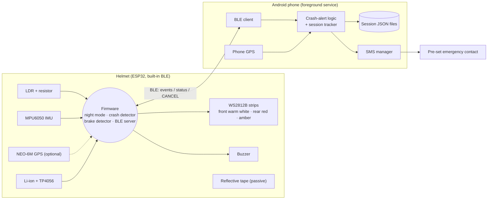
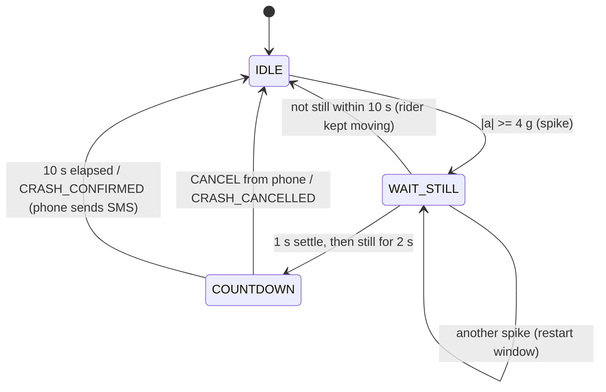

# Architecture

## 1. System overview

**Design principle:** the helmet does the real-time sensing and local warning (works with no phone); the phone supplies what the helmet
lacks: GPS, storage, and a cellular connection for the SMS. That is why the SIM/GPS cost is not duplicated in the helmet.

## 2. Firmware modules (`firmware/src`)

| File | Responsibility |
|---|---|
| `config.h` | pins, thresholds, timings, BLE UUIDs (plain `#define`s) |
| `detectors.h` | `CrashDetector` and `BrakeDetector` state machines; **no Arduino dependency**, unit-tested on a PC |
| `imu_mpu6050.h` | raw I2C MPU6050 driver, 100 Hz, +-16 g, +-500 deg/s |
| `leds.h` | three WS2812B strips; only re-sends data when state changes |
| `ble_link.h` | GATT server, notify helpers, `CANCEL` write handler, auto re-advertise |
| `main.cpp` | cooperative loop (no RTOS tasks): IMU 100 Hz, LDR 10 Hz, LEDs 20 Hz, status 1 Hz |

## 3. Feature logic

### Auto night mode
`LDR -> EMA filter -> hysteresis (1200 / 1800) + 5 s confirmation -> front warm white + rear red`.
Hysteresis and the 5 s hold stop flicker at dusk/dawn and in tunnels or under bridges.

### Crash detection

"Still" = mean |a| within 0.12 g of 1 g **and** standard deviation of |a| over the last 0.5 s below 0.03 g **and** rotation below 15 deg/s.
The variance test is what separates *lying on the road* from *riding smoothly after hitting a pothole*.
During the countdown the buzzer beeps (slow, then fast for the last 5 s) and the amber strip flashes.

### Hard braking (session event)
Forward-axis acceleration minus a slow baseline (removes gravity and head tilt) <= -0.35 g for >= 150 ms, 3 s cool-down.

### Session tracking (phone)
Phone GPS 1 Hz -> accuracy filter (<= 25 m) -> jitter filter (>= 3 m) -> distance/route; BLE events add `HARD_BRAKE` entries stamped with phone time and position.
On "Stop" the app writes `sessions/session_<UTC time>.json` (see `sample-data/session_sample.json`).

## 4. Phone app modules (`android-app/app/src/main/java/com/smarthelmet/app`)

| File | Responsibility |
|---|---|
| `MainActivity.kt` | permissions, emergency-contact field, Start/Stop, live stats, big "I'M OK" button |
| `RideService.kt` | foreground service: owns BLE, GPS, tracker and the crash-alert state machine |
| `BleClient.kt` | scan by service UUID, connect, subscribe, `CANCEL` write, auto-reconnect |
| `SessionTracker.kt` | route, distance, duration, events, JSON export |
| `SmsSender.kt` | multipart SMS via `SmsManager` |
| `RideState.kt` | `StateFlow` UI state + the one stored preference |

## 5. Key design decisions

| Decision | Reason |
|---|---|
| Cancel only by phone ("I'M OK") | the specified hardware has no button; the spec lets the rider cancel manually within 10 s |
| Phone fallback timer (10 s + 1 s) | if BLE drops in the crash, the SMS must still go out |
| Per-incident state (NONE / COUNTDOWN / CANCELLED / SMS_SENT) | guarantees at most one SMS per incident, and none after a cancel |
| Foreground service | Android stops background apps; a ride with the screen off must keep logging and alerting |
| Pure-C++ detectors | thresholds can be tested on a laptop against recorded traces (`firmware/test/host`) |

## 6. Known limitations (be honest in the demo)

- Thresholds are **starting points** from reasoning, not from crash-test data; tune them with real rides (see README -> Calibration).
- The crash path needs a phone with BLE, location and a SIM with credit; no phone = local warning only. If the BLE link is already down when the crash happens, the phone is never told, so no SMS is sent.
- Gyro bias on cheap MPU6050 boards can be several deg/s, so stillness leans on the accelerometer variance.
- The firmware and Android app have been written to the spec but only the detector logic was executed in tests here; hardware bring-up and app build need to be verified on your devices.
- This is a prototype safety aid, **not a certified helmet or medical/emergency device**.
