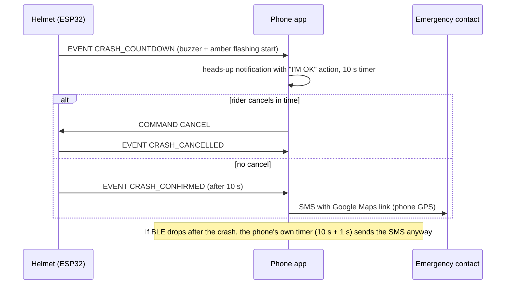

# BLE protocol

The helmet (ESP32) is the **GATT server** (advertises as `SmartHelmet`); the phone app is the **client**.
Payloads are short UTF-8 JSON strings (< 100 bytes). The app requests MTU 185 so they fit in one notification.

| Characteristic | UUID | Properties | Purpose |
|---|---|---|---|
| Service | `7f1c0001-8a52-4f7e-9d3b-5c1a2b3c4d5e` | - | advertised, used by the app's scan filter |
| EVENT | `7f1c0002-...` | notify | one message per event |
| STATUS | `7f1c0003-...` | notify, read | once per second |
| COMMAND | `7f1c0004-...` | write / write-no-response | phone -> helmet |

(`...` = `-8a52-4f7e-9d3b-5c1a2b3c4d5e`)

## EVENT messages

```json
{"e":"HARD_BRAKE","v":0.52,"t":84210}
```
| Field | Meaning |
|---|---|
| `e` | `HARD_BRAKE`, `CRASH_COUNTDOWN`, `CRASH_CANCELLED`, `CRASH_CONFIRMED` |
| `v` | HARD_BRAKE: peak deceleration in g. CRASH_COUNTDOWN / CRASH_CONFIRMED: impact in g. Else 0 |
| `t` | helmet uptime in ms (`millis()`), for ordering only; the app stamps events with phone time |

## STATUS message

```json
{"night":1,"ldr":640,"st":"IDLE"}
```
`night` = auto night mode active, `ldr` = filtered 12-bit ADC value, `st` = crash state (`IDLE`, `WAIT_STILL`, `COUNTDOWN`).
With the optional NEO-6M and a fix, `"lat"` and `"lon"` are added (used by the app only if the phone has no GPS fix).

## COMMAND

Write the ASCII text `CANCEL` to stop the buzzer countdown. The helmet answers with a `CRASH_CANCELLED` event.

## Crash-alert sequence


